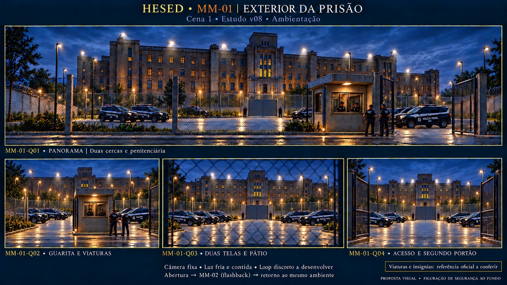

# Storyboard · MM-01 · Exterior/entrada da prisão

| | |
| --- | --- |
| **Responsável** | Victor |
| **Cena** | 1 · Pós-libertação |
| **Etapa** | Storyboard v08 · Q02 corrigido; viaturas provisórias |
| **Recebe de** | Posição cênica final de Goel; foto/frame/planta não fornecidos |
| **Interrupção/retorno** | MM-02, flashback de Goel; depois retorna ao mesmo ambiente MM-01 |
| **Saída** | Encerramento da Cena 1 e transição para a casa MM-03; estado técnico a definir |
| **Controle** | Fala com duração variável; sem timecodes medidos |
| **Drive** | A definir (P-13); nenhum upload realizado |

## Prancha v08 · correção localizada Q02 (D-20)

**Conceito:** exterior de prisão contemporânea, austero, com figuração de segurança discreta, que sustenta a atuação presencial e o retorno do flashback. Panorama e três detalhes do mesmo espaço, sem cortes narrativos adicionais.

**Diretriz atual do usuário (D-16):** preservar prédio/guarita, substituir grades por duas cercas de tela, manter muros só nas laterais com concertina e acrescentar refletores altos voltados para fora. Segundo portão de aço maciço no acesso ao fundo, com sentinelas. Dois agentes na guarita, agentes externos e viaturas atrás/ao lado dela no primeiro pátio. Polícia **Penal de Minas Gerais**, distinta da Militar. Isso autoriza figuração de segurança projetada; Jesus e detentas continuam no palco.

**Limitação aberta:** cores, modelo e marca das viaturas/uniformes ainda não conferidos. A foto indicada pelo usuário retornou 403 e não pôde ser vista nem usada na geração. SUVs e insígnias na prancha são provisórios; não afirmar reprodução oficial ou da frota mais recente. A identificação correta depende do recebimento da foto anexada. Arquitetura de referência verbal Prison Break, sem frame da série fornecido. **V08 para avaliação de Q02; Q01/Q03/Q04 da v07 foram considerados corretos pelo usuário.**

**Correções atuais:** segundo portão no eixo da entrada principal, conforme Q04 (D-17). Quantidade da v05 mantida a pedido do usuário (D-19), com grupos dos dois lados presentes nos quatro ângulos (D-18). Detalhes reenquadrados para caber a frota; a redução da v06 foi recusada. A contagem visual de seis SUVs deriva do panorama de referência, não de número fixado verbalmente pelo usuário. **D-20:** Q02 corrigido para remover a entrada extra à esquerda e recompor tela contínua; preservar os demais quadros.

## Quadros

| ID | O que se vê | Movimento/uso | Gatilho |
| --- | --- | --- | --- |
| MM-01-Q01 | Panorama: duas telas, guarita/viaturas, segundo portão e penitenciária | Composição principal; futura câmera fixa e loop ambiental discreto, sem animar o portão | Abertura da cortina; reutilizar no retorno de MM-02 |
| MM-01-Q02 | Guarita com dois agentes e viaturas provisórias ao lado | Detalhe espacial para revisão, sem corte obrigatório | Mesmo ambiente Q01 |
| MM-01-Q03 | Vista através das duas telas ao pátio, portão maciço e penitenciária | Detalhe espacial para revisão, sem ação adicional | Mesmo ambiente Q01 |
| MM-01-Q04 | Acesso externo aberto, segundo portão maciço e sentinelas | Detalhe espacial para revisão, sem sequência de abertura do portão | Mesmo ambiente Q01 |

## Palco e telão

Jesus e dez detentas estão **no palco**, retomando a posição final de Goel. Jesus sai pelo corredor central enquanto elas permanecem congeladas; depois se levantam e discutem. Religiosidade permanece sentada. O telão oferece ambientação, sem duplicar esses personagens; os agentes de segurança projetados foram acrescentados por pedido explícito do usuário (D-16). A Bíblia corrige a indicação original de cadeia: não há estrutura física de cadeia, correntes ou cruz física na abertura.

A discussão congela para o vídeo MM-02, feito separadamente. Ao fim dele, retoma imediatamente no mesmo ambiente MM-01. Esse congelamento é diferente do inicial, durante a saída de Jesus. Não inventar duração, blackout ou música para a imagem. Estado do telão no encerramento segue a definir (P-08/P-15).

## Primeiro e último frame

- **Primeiro:** exterior Q01 na abertura da cortina, apoiando a continuidade cênica de Goel sem afirmar reprodução arquitetônica da montagem anterior.
- **Espera/retorno:** mesma base durante as falas e após MM-02; futuro loop com início/fim compatíveis, ainda não produzido.
- **Último:** preservar o ambiente até o gatilho técnico combinado; não há transição renderizada ou duração definida.

## Fontes e rastreabilidade

[Bíblia de Produção](../../docs/fontes/HESED_Biblia_de_Producao_v0_1.md) §§2.2/3/5.2/7.1/9/16, [roteiro Cena 1](../../docs/roteiro.md), [briefing Bloco I](../../docs/briefing.md), [alinhamento das fontes](../../docs/alinhamento-das-fontes.md), [Victor](../../equipe/victor.md), [guia](../guia-de-construcao.md) e [briefings/registro dos quadros](../briefings-dos-quadros.md#mm-01--exteriorentrada-da-prisão).

- [Prompt integral vigente](prompt-prancha-v08.txt); edição em `image_gen.imagegen` com [v07](prancha-v07.jpg) inspecionada e usada como única referência visual. [Prompt do alinhamento v04](prompt-prancha-v04.txt), [ensaio de continuidade v05](prompt-prancha-v05.txt) e [redução substituída v06](prompt-prancha-v06.txt) preservados com registros no caderno.
- Original PNG preservado fora do repositório: `/workspace/generated_images/exec-f7aa129d-df5b-4f2d-a78b-50b83860f5dc.png`.
- Prancha JPEG leve no repositório: **1672×941**, **603513 bytes**; sem mudança de composição na conversão. AR próximo de 16:9; não é a resolução final de exibição.
- Painel informado ≈6×3 m; matriz, fps e codec seguem pendentes (P-01). Base limpa, animação e teste no LED ainda não realizados.
- A transcrição original da reunião não foi recebida (P-14); a Bíblia é uma consolidação, não a transcrição.

## Revisão visual e pendências

O panorama preserva a frota v05; Q02/Q03/Q04 mostram grupos dos dois lados e portão no eixo da entrada. Q02 agora tem enquadramento mais aberto com guarita centralizada. A ferramenta redesenhou os detalhes, portanto são estudos de continuidade, sem validação métrica de perspectiva/distâncias. Conferir relações de escala e oclusão antes de base definitiva e teste LED. **Q01/Q03/Q04 da v07 considerados corretos pelo usuário; correção Q02/v08 ainda para avaliação.**

**Viaturas/insígnias:** [referência indicada pelo usuário](https://viuitauna.com.br/wp-content/uploads/2022/12/Policia-Penal-Fotos-Divulgacao-Governo-de-Minas-1.jpeg), recebida enquanto a geração estava em andamento. O servidor/proxy retornou 403 nas tentativas; foto não vista, não baixada e não enviada à ferramenta. Necessário anexá-la para acertar modelo, cores e marca. A prancha avisa que essa referência ainda será conferida. Não confundir o ano no caminho do link com confirmação do modelo mais recente.

**Histórico:** [v01](prancha-v01.jpg), leitura inicial; [v02](prancha-v02.jpg), prédio/guarita; [v03](prancha-v03.jpg), telas/segurança; [v04](prancha-v04.jpg), portão alinhado; [v05](prancha-v05.jpg), quantidade de viaturas mantida por escolha do usuário; [v06](prancha-v06.jpg), redução recusada/substituída. [v07](prancha-v07.jpg), frota preservada, com erro de entrada extra no Q02. **V08 é a proposta atual**, removendo essa entrada indevida e colocando tela. Nenhuma versão tem aceite técnico.

A pausa documental registrada em D-14 foi cumprida antes do storyboard; revisão atual autorizada pelo pedido posterior D-16.
