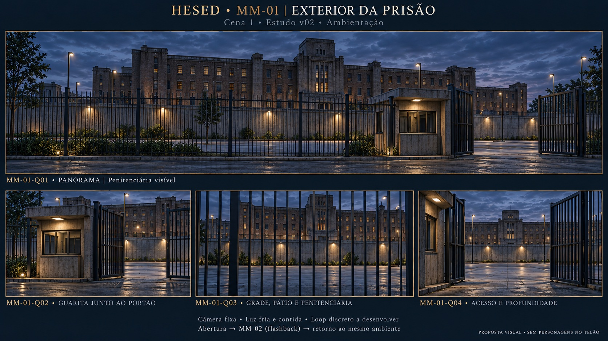

# Storyboard · MM-01 · Exterior/entrada da prisão

| | |
| --- | --- |
| **Responsável** | Victor |
| **Cena** | 1 · Pós-libertação |
| **Etapa** | Storyboard v02 · revisão arquitetônica D-15 |
| **Recebe de** | Posição cênica final de Goel; foto/frame/planta não fornecidos |
| **Interrupção/retorno** | MM-02, flashback de Goel; depois retorna ao mesmo ambiente MM-01 |
| **Saída** | Encerramento da Cena 1 e transição para a casa MM-03; estado técnico a definir |
| **Controle** | Fala com duração variável; sem timecodes medidos |
| **Drive** | A definir (P-13); nenhum upload realizado |

## Prancha v02 · revisão D-15

**Conceito:** exterior de prisão contemporânea, austero e vazio, que sustenta a atuação presencial e o retorno do flashback. Panorama e três detalhes do mesmo espaço, sem cortes narrativos adicionais.

**Diretriz do usuário (D-15):** referência verbal Prison Break, grade no limite frontal para enxergar o interior, guarita junto ao portão, pátio/passagem com profundidade, muro mais distante e prédio penitenciário visível atrás/acima dele. Grade projetada, sem alterar a retirada de grade física no palco. **A arte v02 segue para avaliação:** acabamento institucional de tijolo/pedra, desenho dos pavimentos, vegetação e entardecer são escolhas do estudo. Nenhum frame da série foi fornecido ou consultado. A v01 não comunicava prisão suficientemente e permanece apenas como histórico.

## Quadros

| ID | O que se vê | Movimento/uso | Gatilho |
| --- | --- | --- | --- |
| MM-01-Q01 | Panorama: grade, guarita junto ao portão, pátio, muro recuado e penitenciária | Composição principal; futura câmera fixa e loop ambiental discreto, sem animar o portão | Abertura da cortina; reutilizar no retorno de MM-02 |
| MM-01-Q02 | Detalhe da guarita contígua ao portão | Detalhe espacial para revisão, sem corte obrigatório | Mesmo ambiente Q01 |
| MM-01-Q03 | Vista através da grade ao pátio, muro e penitenciária | Detalhe espacial para revisão, sem ação adicional | Mesmo ambiente Q01 |
| MM-01-Q04 | Detalhe do acesso aberto em perspectiva para o muro e a penitenciária | Detalhe espacial para revisão, sem sequência de abertura do portão | Mesmo ambiente Q01 |

## Palco e telão

Jesus e dez detentas estão **no palco**, retomando a posição final de Goel. Jesus sai pelo corredor central enquanto elas permanecem congeladas; depois se levantam e discutem. Religiosidade permanece sentada. O telão oferece ambientação, sem duplicar esses personagens. A Bíblia corrige a indicação original de cadeia: não há estrutura física de cadeia, correntes ou cruz física na abertura.

A discussão congela para o vídeo MM-02, feito separadamente. Ao fim dele, retoma imediatamente no mesmo ambiente MM-01. Esse congelamento é diferente do inicial, durante a saída de Jesus. Não inventar duração, blackout ou música para a imagem. Estado do telão no encerramento segue a definir (P-08/P-15).

## Primeiro e último frame

- **Primeiro:** exterior Q01 na abertura da cortina, apoiando a continuidade cênica de Goel sem afirmar reprodução arquitetônica da montagem anterior.
- **Espera/retorno:** mesma base durante as falas e após MM-02; futuro loop com início/fim compatíveis, ainda não produzido.
- **Último:** preservar o ambiente até o gatilho técnico combinado; não há transição renderizada ou duração definida.

## Fontes e rastreabilidade

[Bíblia de Produção](../../docs/fontes/HESED_Biblia_de_Producao_v0_1.md) §§2.2/3/5.2/7.1/9/16, [roteiro Cena 1](../../docs/roteiro.md), [briefing Bloco I](../../docs/briefing.md), [alinhamento das fontes](../../docs/alinhamento-das-fontes.md), [Victor](../../equipe/victor.md), [guia](../guia-de-construcao.md) e [briefings/registro dos quadros](../briefings-dos-quadros.md#mm-01--exteriorentrada-da-prisão).

- [Prompt integral da revisão](prompt-prancha-v02.txt); edição em `image_gen.imagegen` com [v01](prancha-v01.jpg) inspecionada como referência de apresentação/luz. [Prompt v01 preservado](prompt-prancha-v01.txt).
- Original PNG preservado fora do repositório: `/workspace/generated_images/exec-a0c1e4f8-bf51-46d2-b9ab-759fc24165f9.png`.
- Prancha JPEG leve no repositório: **1672×941**, **560390 bytes**; sem mudança de composição na conversão. AR próximo de 16:9; não é a resolução final de exibição.
- Painel informado ≈6×3 m; matriz, fps e codec seguem pendentes (P-01). Base limpa, animação e teste no LED ainda não realizados.
- A transcrição original da reunião não foi recebida (P-14); a Bíblia é uma consolidação, não a transcrição.

## Revisão visual e pendências

A penitenciária agora aparece atrás do muro distante; grade frontal permite ver o pátio e a guarita fica junto ao portão. Sem personagens, correntes ou cruz. Conferir sombras no LED e continuidade arquitetônica dos detalhes antes da base definitiva: Q03 aproxima bastante a grade e os detalhes não são recortes exatos do panorama. **Aprovação artística da v02 pendente.**

**Histórico:** [prancha v01](prancha-v01.jpg), anterior à correção D-15. Não usar como direção arquitetônica vigente.

A pausa documental registrada em D-14 foi cumprida; este storyboard foi iniciado pelo pedido posterior “vamos ao MM01”.
