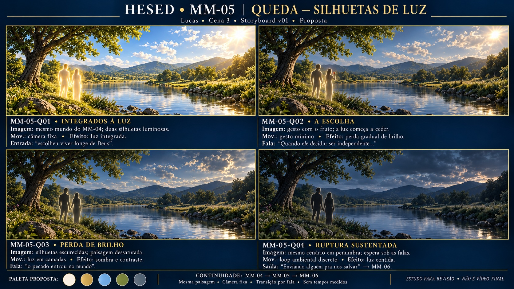

# Storyboard · MM-05 · Queda — silhuetas de luz

| | |
| --- | --- |
| **Responsável** | Lucas |
| **Cena / bloco** | 3 · Bloco II |
| **Versão / situação** | v01 · 16/10/2026 · proposta para revisão |
| **Recebe de** | Melissa/MM-04: paisagem luminosa, paleta e estado corrente do loop |
| **Entrega para** | Isaac/MM-06: saída em “Enviando alguém pra nos salvar” |
| **Entrada** | “Deu errado quando o ser humano escolheu viver longe de Deus” |
| **Controle** | Fala variável; transformação e espera/loop, sem tempos medidos |
| **Drive** | A definir (P-13); nenhum upload realizado |

## Prancha v01

**Conceito:** o mesmo mundo luminoso da criação perde harmonia; duas silhuetas humanas perdem gradualmente a luz, enquanto a paisagem ganha sombras, menos saturação e peso. Não trocar de mundo nem transformar a queda em catástrofe visual.

[Prancha](prancha-v01.jpg) · [Prompt integral](prompt-prancha-v01.txt) · [Briefings e registro](../briefings-dos-quadros.md#mm-05--queda--silhuetas-de-luz)

## Quadros

Quatro estados de uma composição para transformação contínua; não quatro cenários ou cortes obrigatórios. Gatilhos intermediários abaixo são propostas para ensaio, sem segundos medidos.

| ID | Imagem | Movimento / efeitos | Relação com fala |
| --- | --- | --- | --- |
| MM-05-Q01 · Integrados à luz | Mesma paisagem da MM-04, duas silhuetas branco-douradas na margem esquerda | Câmera fixa; integração luminosa discreta | Entrada: “escolheu viver longe de Deus” |
| MM-05-Q02 · A escolha | Uma figura ergue pequeno fruto; brilho começa a ceder | Gesto mínimo proposto; reduzir luz e saturação | “Quando ele decidiu ser independente...” |
| MM-05-Q03 · Perda de brilho | Figuras mais escuras, contorno residual; natureza reconhecível | Máscaras/opacidade, sombras e contraste | “o pecado entrou no mundo”; seguir narrativa |
| MM-05-Q04 · Ruptura sustentada | Mesmo ambiente em penumbra, duas figuras permanecem | Espera em futuro loop discreto; não apagar totalmente | Sustentar falas até “Enviando alguém pra nos salvar” → MM-06 |

## Palco e conteúdo projetado

As detentas ouvem a história no palco, com a casa/mesa presentes fisicamente. O briefing pede silhuetas humanas na queda; a indicação do roteiro de Adão/Eva e fruto é traduzida numa ação simbólica breve, sem duplicar elenco, encenar os dez pecados ou exigir novos atores filmados. A Bíblia permite Adão/Eva em mídia. Duas figuras abstratas, sem identidade facial/anatomia explícita, são a proposta deste estudo.

Não antecipar cruz, Jesus, infância ou bebê: pertencem à regressão da MM-06. A lista de pecados permanece na fala; não criar montagem literal adicional. A transcrição original da reunião não foi recebida (P-14).

## Costuras e primeiro/último estado

- **Primeiro:** mundo ainda íntegro, seguindo [MM-04 v01](../MM-04/prancha-v01.jpg), com silhuetas integradas à luz. A prancha da MM-04 é estudo ainda não aprovado, não base final recebida.
- **Geografia:** árvore grande à esquerda, lago/trecho largo de água central, margens/pedras e colinas. Fonte luminosa inicial à direita; manter enquadramento e geografia ao reduzir brilho/cor.
- **Último:** penumbra legível com figuras ainda presentes. Esperar durante a lista dos pecados, promessa e diálogo; sair pela fala de envio ao salvador para MM-06. Frame de Isaac/método de transição a alinhar, sem corte/fade ou duração final aprovados.
- **Produção:** derivar os estados de uma base piloto aceita, com figuras/luz em camadas; testar loop do estado final. Prancha não comprova loop ou animação.

## Fontes e arquivo

[Briefing v1.0](../../docs/briefing.md), §11/MM-05 e §8/MM-04; [roteiro Cena 3](../../docs/roteiro.md); [Bíblia canônica](../../docs/fontes/HESED_Biblia_de_Producao_v0_1.md) §§3/5.2/7.1/9; [alinhamento](../../docs/alinhamento-das-fontes.md); [Lucas](../../equipe/lucas.md); [mapa](../../docs/mapa-de-cenas.md); [dependências](../../docs/dependencias.md); [guia](../guia-de-construcao.md) e [caderno](../briefings-dos-quadros.md#mm-05--queda--silhuetas-de-luz).

- Ferramenta: `image_gen.imagegen`, fundo opaco. Referência visual efetivamente enviada: prancha MM-04 v01, inspecionada. Sem referências externas ou áudio master.
- Original: `/workspace/generated_images/exec-2582da56-15e8-400b-bfd7-0b86dfe5b358.png`, PNG 1672×941, 2768857 bytes, preservado fora do repositório.
- Arquivo leve: `prancha-v01.jpg`, JPEG **1672×941**, **695213 bytes**; conversão de formato sem mudar composição.
- AR próximo de 16:9; não é base 4K ou especificação final do LED. P-01 segue aberta para matriz/fps/codec; não houve Drive, vídeo ou teste de palco/LED.

## Revisão e próximo passo

A progressão de brilho e sombra está legível, as duas figuras permanecem e o mundo não muda para outro cenário. Há pequenas variações gerativas em árvore/pedras/colinas/nuvens entre quadros; não recortar a prancha como quatro bases finais independentes. Conferir brilho residual dos contornos e nível de penumbra no LED.

**Aprovação artística pendente.** Revisar a proposta, alinhar base/paleta com Melissa/MM-04 e estado de entrada com Isaac/MM-06 antes do alpha. Referências e sincronização definitivas não foram aprovadas por esta geração.
