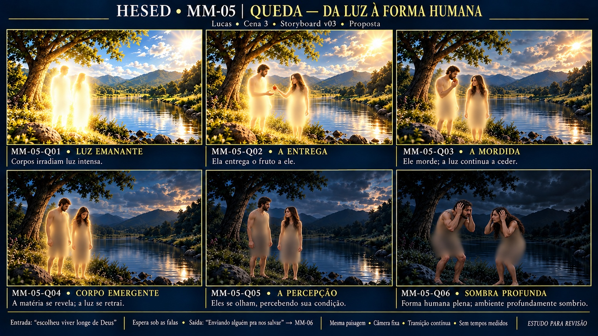

# Storyboard · MM-05 · Queda — da luz à forma humana

| | |
| --- | --- |
| **Responsável** | Lucas |
| **Cena / bloco** | 3 · Bloco II |
| **Versão / situação** | v03 · seis quadros · 16/10/2026 · proposta para revisão |
| **Recebe de** | Melissa/MM-04: paisagem luminosa, paleta e estado corrente do loop |
| **Entrega para** | Isaac/MM-06: “Enviando alguém pra nos salvar” |
| **Entrada** | “Deu errado quando o ser humano escolheu viver longe de Deus” |
| **Controle** | Fala variável; transformação e espera/loop, sem tempos medidos |
| **Drive** | A definir (P-13); nenhum upload realizado |

## Prancha v03 · seis estados

**Direção do usuário (D-22):** ampliar para seis quadros, aumentar a luz emanando dos corpos no início e revelar gradualmente pessoas fisicamente reconhecíveis no último. Final muito mais escuro e sombrio, casal em desespero, mãos na cabeça, olhando um para o outro e levemente encurvado/prostrado. Essa direção substitui o final apenas em silhuetas da v01; a arte nova ainda depende de avaliação. **D-23:** Q02 ela entrega o fruto, Q03 ele morde, Q05 trocam olhares percebendo a condição; retirar a leitura de roupa e ocultar o corpo com desfoque. Para não gerar nudez, a edição bem-sucedida aplicou desfoque opaco sobre áreas já cobertas da referência, ocultando detalhes de roupa/anatomia. Q06 mantém desespero.

[Prancha atual](prancha-v03.jpg) · [Prompt efetivo do ajuste](prompt-ajuste-desfoque-v03.txt) · [Contrato/registro](../briefings-dos-quadros.md#revisão-mm-05-v03--d-23)

## Quadros

Seis estados do mesmo mundo, não seis ambientes ou cortes obrigatórios. Q01–Q04 mantêm seus IDs com conteúdo revisado; Q05/Q06 acrescentados, Q04 deixa de ser final. Progressão orientada pela fala/ensaio, sem segundos inventados.

| ID | Instante visual | Movimento / efeitos propostos |
| --- | --- | --- |
| MM-05-Q01 · Luz emanante | Corpos irradiam branco/dourado intenso sobre chão e vegetação | Luz própria forte em camadas; câmera fixa |
| MM-05-Q02 · A entrega | Mulher oferece fruto ao homem; brilho ainda intenso | Gesto de entrega; reduzir emissão |
| MM-05-Q03 · A mordida | Homem morde; rosto/volume físico aparecem | Revelação física e redução da luz |
| MM-05-Q04 · Corpo emergente | Pessoas majoritariamente físicas com brilho residual | Retrair luz e aumentar sombra/frio |
| MM-05-Q05 · A percepção | Quase sem emissão, casal se olha percebendo a condição | Olhar mútuo, transição para desespero |
| MM-05-Q06 · Sombra profunda | Pessoas físicas sem aura, em desespero; mãos na cabeça, encurvadas, olhares mútuos; mundo profundamente sombrio | Futuro loop discreto sob falas; sair pelo gatilho MM-06 |

## Palco, identidade e costuras

Detentas ouvem a história no palco com casa/mesa presentes fisicamente; não duplicá-las no LED. O briefing pede perda de luz das silhuetas e o roteiro cita Adão/Eva/fruto; D-22 amplia o final para pessoas físicas. Bíblia permite Adão/Eva em mídia. Dois adultos de pele oliva/morena, cabelos escuros, homem à esquerda com barba curta e mulher à direita com cabelo longo, identidade física proposta e não elenco aprovado. D-23 substitui as vestes rústicas da v02: corpo desfocado sem detalhes íntimos expostos, rostos/mãos/gestos legíveis.

- **Primeiro estado:** paisagem luminosa da [MM-04](../MM-04/prancha-v01.jpg) com luz emanando dos corpos; referência é estudo ainda sem base final aceita.
- **Geografia:** árvore à esquerda, lago/água central, pedras/margens e colinas; preservar câmera e locais das figuras em produção.
- **Último:** ambiente sombrio e pessoas legíveis por luz refletida discreta, sem brilho próprio. Segurar lista de pecados/promessa/diálogo até “Enviando alguém pra nos salvar” → MM-06.
- **Limite:** cruz, Jesus, infância/bebê pertencem à MM-06. Não antecipar redenção, destruir a paisagem ou montar cada pecado literalmente. Frame de Isaac e transição técnica ainda a alinhar.
- **Produção:** derivar de base piloto, pessoas e luz em camadas, com consistência de rosto/escala/paisagem. A prancha não comprova transformação animada ou loop sem emenda.

## Fontes e rastreabilidade

[Briefing](../../docs/briefing.md) §11/MM-05 e §8/MM-04; [roteiro Cena 3](../../docs/roteiro.md); [Bíblia](../../docs/fontes/HESED_Biblia_de_Producao_v0_1.md) §§3/5.2/7.1/9; [D-22/D-23](../../docs/decisoes.md); [alinhamento](../../docs/alinhamento-das-fontes.md); [Lucas](../../equipe/lucas.md); [dependências](../../docs/dependencias.md); [guia](../guia-de-construcao.md) e [caderno](../briefings-dos-quadros.md#revisão-mm-05-v02--d-22). Transcrição original ausente (P-14).

- Ferramenta: `image_gen.imagegen`, fundo opaco, única referência [v02](prancha-v02.jpg), inspecionada. Sem referência fotográfica externa de atores.
- A [tentativa inicial v03](prompt-prancha-v03.txt) foi bloqueada pelo gerador e não retornou arquivo. A [alternativa efetivamente gerada](prompt-ajuste-desfoque-v03.txt) desfoca de forma opaca as áreas já cobertas da fonte, sem gerar nudez sob o desfoque; preserva rostos/mãos e corrige gestos.
- Original final: `/workspace/generated_images/exec-70525e9d-a674-451a-9581-0ad1af1096d7.png`, PNG 1672×941, 2624174 bytes, preservado fora do repositório.
- Arquivo leve: `prancha-v03.jpg`, JPEG **1672×941**, **666212 bytes**, conversão de formato sem mudar composição. Aproximadamente 16:9; não é base 4K/matriz final do painel (P-01).
- Histórico: [v01 de quatro quadros](prancha-v01.jpg), [prompt v01](prompt-prancha-v01.txt), [v02 de seis quadros](prancha-v02.jpg), [prompt v02](prompt-prancha-v02.txt) e [refinamento Q06/v02](prompt-ajuste-Q06-v02.txt), preservados com originais/metadata no caderno.

## Revisão

Q02/Q03/Q05 corrigidos, corpo oculto por desfoque e Q06 com desespero. Desfoque tem bordas relativamente uniformes; estética pode ser revisada conforme feedback. Pequenas mudanças gerativas de rosto/cabelo/escala/paisagem exigem uma base única antes de animar; prancha não valida continuidade métrica. Conferir gradação de luz e escuros no LED.

**Aprovação artística da v03 pendente.** Sem alpha, base individual, loop testado ou aceite LED; costuras MM-04/MM-06 e especificações técnicas abertas.
