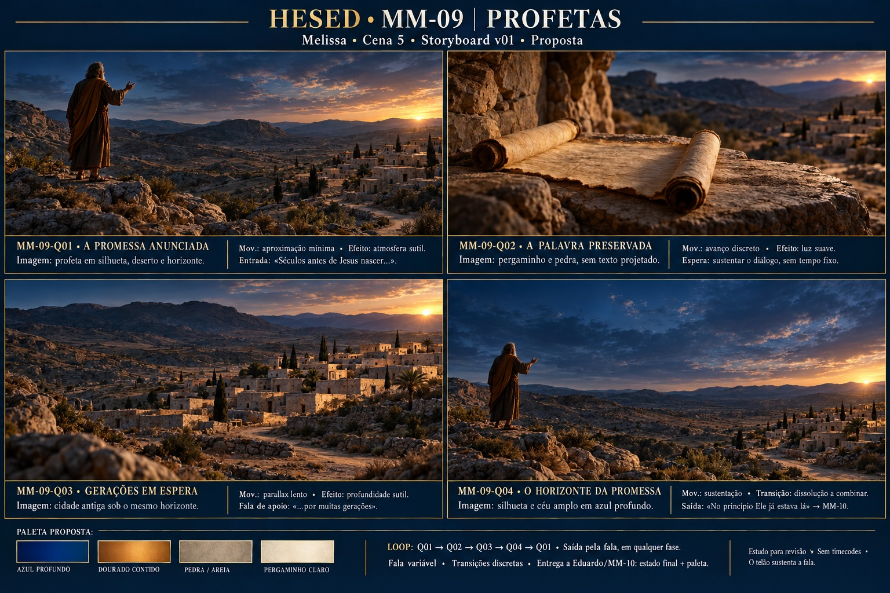

# Storyboard · MM-09 · Profetas (loop)

| | |
| --- | --- |
| **Responsável** | Melissa |
| **Cena** | 5 · Bloco III |
| **Versão / situação** | v01 · 16/10/2026 · proposta para revisão |
| **Recebe de** | Nenhum fornecedor/frame de entrada definido na documentação |
| **Entrega para** | MM-10 (Eduardo): último estado visual, paleta e direção de movimento |
| **Entrada** | “Bom, séculos antes de Jesus nascer, houveram vários profetas que anunciaram a vinda dele.” |
| **Saída** | “No princípio Ele já estava lá.” |
| **Controle** | Fala de duração variável; sem música própria ou timecodes |
| **Pasta no Drive** | A definir (P-13); nada enviado ao Drive neste trabalho |

## Conceito em uma frase

Um vale antigo, um profeta, o pergaminho e a cidade evocam promessa e espera em um ciclo contemplativo que sustenta a fala e prepara a passagem para o MM-10.

## Prancha v01

[Ver prancha](prancha-v01.jpg) · [Prompt enviado](prompt-prancha-v01.txt) · [Briefings dos quadros](../briefings-dos-quadros.md#mm-09--profetas)

Estudo visual gerado por IA: **1536×1024**, JPEG leve (547,263 bytes). O PNG original está em `/workspace/generated_images/exec-50e801b8-84e4-4fec-bf45-408dbaab36e4.png`, fora do repositório; não é armazenamento compartilhado permanente. Bases individuais finais têm referência documental de 3840×2160 e não foram produzidas neste trabalho.

## Quadros

| ID | O que se vê | Movimento / efeitos / transição | Relação com a fala |
| --- | --- | --- | --- |
| MM-09-Q01 · A promessa anunciada | Profeta não identificado em silhueta à esquerda; vale árido e cidade à direita | Aproximação mínima, atmosfera discreta; dissolução lenta | Entrada na explicação dos profetas |
| MM-09-Q02 · A palavra preservada | Pergaminho sobre pedra no mesmo ambiente, sem escrita legível | Avanço discreto, luz suave; pergaminho já aberto | Sustentação do diálogo, sem cue obrigatório |
| MM-09-Q03 · Gerações em espera | Cidade de pedra clara sob o mesmo horizonte | Parallax lento e discreto; sem passagem literal de séculos | Apoio à ideia de esperar por gerações e às interrupções |
| MM-09-Q04 · O horizonte da promessa | Mesmo profeta e vale com céu amplo azul profundo | Sustentação; retorno a Q01 ou dissolução a combinar com Eduardo | “No princípio Ele já estava lá” dispara MM-10 em qualquer fase |

## Primeiro e último estado

- **Entrada:** profeta no vale; transição de entrada a combinar, sem frame anterior recebido.
- **Ciclo:** Q01 → Q02 → Q03 → Q04 → Q01, com transições discretas. Quadros não têm obrigação de coincidir com frases, exceto disparo e saída. Testar a repetição no alpha.
- **Saída:** pelo gatilho de fala em qualquer fase, sem aguardar Q04. Preparar a passagem do histórico ao azul profundo do MM-10; receber/conferir o arquivo real de Eduardo antes de fechar a costura.
- **Paleta proposta:** azul profundo, dourado contido, pedra/areia e pergaminho claro. Mesma luz baixa quente da direita nos quadros; sem progressão de clímax ou ciclo dia/noite.
- **Personagem proposto:** profeta genérico mais velho, túnica terrosa e manto ocre, rosto pouco detalhado; não identifica um profeta bíblico específico nem representa o elenco.

## Fontes e revisão

Fontes: [briefing](../../docs/briefing.md) MM-09, [roteiro](../../docs/roteiro.md) Cena 5, D-00, mapa de cenas, dependências, página de Melissa, guia de construção, caderno e contrato/Q01/Q02 do MM-10. Referências visuais do Dudu e frame real de MM-10 não disponíveis; não utilizados como imagens de referência.

**Feedback:** Atmosfera histórica, pergaminho sem escrita legível, identidade geral do profeta, paleta e anotações conferidos visualmente pelo Codex. Há variações na postura/escala do profeta, nas construções e nas colinas entre quadros; Q04 não repete exatamente Q01. Para produção, fixar uma referência de ambiente/personagem e derivar Q04 de Q01. O sol visível e os realces quentes precisam ter brilho testado com palco e falas. A prancha não comprova repetição sem emenda ou integração com o arquivo real de Eduardo.

**Aprovação:** pendente. Sem alpha, animação, loop testado ou aceite no telão. P-01, P-12 e P-13 continuam abertas. Os materiais de MM-04 e Eduardo foram preservados.

## Próximos passos

- Revisar composição e estabelecer referências piloto de personagem e cenário antes das bases individuais.
- Alinhar e compartilhar com Eduardo o estado de saída e a paleta; avisar o grupo quando a costura for definida.
- Produzir alpha em loop com movimentos discretos, testar repetição e brilho durante as falas e no telão real.
